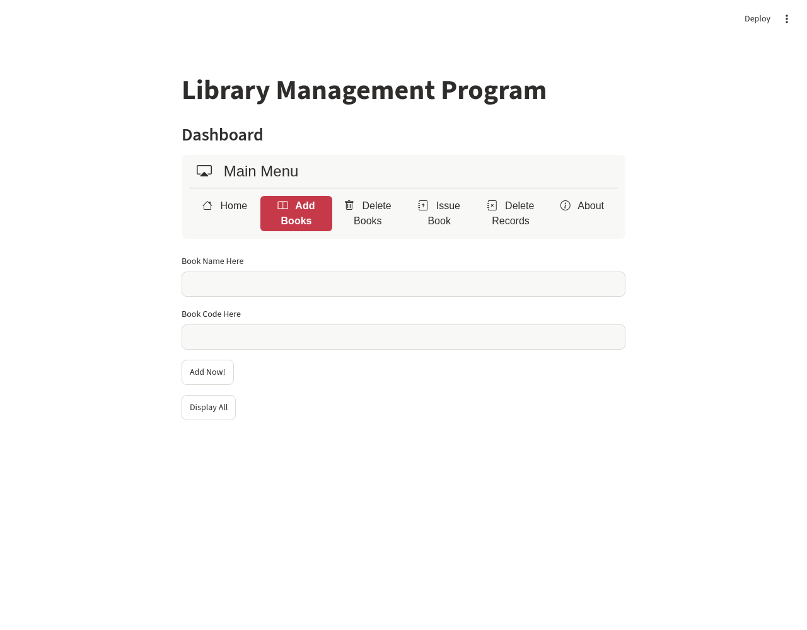

# Library Management Streamlit App

A simple local Python app built with Streamlit and SQLite. Run it to explore adding books, viewing saved books, issuing a book, and viewing issue records.



## Run locally

Use **Python 3.13** with `pip` and `venv` for the recommended starting path. **Python 3.11, 3.12 and 3.13** passed fresh-install, regression and startup checks on Linux x86_64. The pinned Streamlit version requires Python 3.11 or newer; Python 3.10 and earlier cannot install it. Python 3.14 and macOS have not been tested.

Windows commands and an automated Windows check are provided below. **Windows execution is pending**, not verified. See the [compatibility check record](docs/setup-check.md) for exact environments and results.

Clone the repository, or download and extract its ZIP. Open a terminal in the project folder. For a Git clone:

```text
git clone https://github.com/mrtechnostart-python-scripts/Library_Management_Streamlit_App.git
cd Library_Management_Streamlit_App
```

### Linux

Install Python 3.13 with `venv` and `pip` through your Python distribution or OS package manager, then run:

```bash
python3.13 -m venv .venv
.venv/bin/python -m pip install -r requirements.txt
.venv/bin/python -m pip check
.venv/bin/python -m streamlit run Library.py
```

If you have Python 3.11 or 3.12 instead, substitute `python3.11` or `python3.12` in the first command. The remaining commands are unchanged.

### Windows PowerShell

Install Python 3.13 with the Python launcher (`py`), then run:

```powershell
py -3.13 -m venv .venv
.\.venv\Scripts\python.exe -m pip install -r requirements.txt
.\.venv\Scripts\python.exe -m pip check
.\.venv\Scripts\python.exe -m streamlit run Library.py
```

For Python 3.11 or 3.12, substitute `py -3.11` or `py -3.12` in the first command. These commands call the environment's Python directly, so PowerShell activation and execution-policy changes are not required. If `py` is unavailable, use the full path to your installed Python executable to create the environment.

Open the **Local URL** printed in the terminal (normally `http://localhost:8501`). You should see **Library Management Program**, **Dashboard**, and the seven-page menu. Select **Add Books** to see the page pictured above. Stop the app with `Ctrl+C`.

You can also activate the environment (`source .venv/bin/activate` on Linux or `.\.venv\Scripts\Activate.ps1` in PowerShell if permitted) and use `streamlit run Library.py`.

SQLite comes with Python; there is no separate database installation or hosted account to create.

## Try a separate sample collection

Run `streamlit run Library.py`, then choose **Sample collection** under **Local collection** in the sidebar. On a narrow screen, open the sidebar first. This creates `library-sample.db` beside the app with three sample books. In this mode the app does not open or change `library.db`.

1. Open **Add Books**, enter `My Test Book` and code `TRY-001`, then click **Add Now!**. Click **Display All** to see the three sample books and your new book.
2. Open **Issue Book**. Enter college ID `TEST-001`, course `Reading`, book code `TRY-001`, and student name `Sample Reader`. Click **Submit**, then **Display Records** to see the saved issue.
3. Stop the app with `Ctrl+C` and run `streamlit run Library.py` again. Choose **Sample collection** again. **Add Books → Display All** and **Issue Book → Display Records** show the saved book and issue.
4. To return the book before it is overdue, open **Delete Records**, enter college ID `TEST-001` and book code `TRY-001`, then click **Delete Now!**. The issue disappears; the book stays in the collection.
5. Restart and choose **Sample collection** once more. The book remains in **Display All** and the returned issue is absent from **Display Records**.

Use a different book code and college ID if you repeat the walkthrough; duplicate entries are not prevented. Sample initialization happens only once. Your additions, deletions, and issues survive restarts. To start over, stop the app and remove **only `library-sample.db`**; the next sample selection creates fresh sample records. This file is ignored by Git.

Every new app session starts on **Existing library**, preserving the original default. Choose **Sample collection** before entering test records. The sidebar identifies the active file on every page; switching collections clears unfinished form entries.

The app saves the issue date and a return date seven days later. **Delete Books** removes books by name and code. **Delete Records** removes issue records by college ID and book code when they are not overdue. For overdue records, it displays a fine of 10 INR per day and keeps the record; payment handling is not implemented.

## Find a book by code or title

Choose **Existing library** or **Sample collection** in the sidebar, then open **Find Books**. The page identifies the collection and database file being searched.

Enter any part of a book code or title in **Book code or title**, then press Enter or leave the input to apply it. Search checks both fields, ignoring upper and lower case with Unicode case folding (for example, `STRASSE` matches `Straße`). Spaces and punctuation are literal, not wildcards: `%`, `_`, quotes and leading zeros keep their meaning. Saved titles containing Unicode or line breaks can be found by a matching part of the title. Dates and issue/student records are not searched.

Matching books show their saved `BookName`, `BookCode` and `DateAdded`, with a result count. Duplicate records remain separate rows in insertion order. If nothing matches, the page suggests another query or clearing it; an empty collection has its own message. Click **Clear search** or empty the input to see every book again, including records with empty titles or codes. Switching collections clears the query and shows only the newly selected collection.

Search and clearing do not change saved records or open the other database. Results refresh on each page update, including after adding, deleting or importing books. This lightweight search reads the selected book table and filters it locally; large-collection performance has not been measured.

## Export book records to CSV

Choose **Existing library** or **Sample collection** in the sidebar, then open **Add Books → Export book records**. Check the collection name and database filename above the download button. Click **Download … books as CSV** to save `existing-library-books.csv` or `sample-collection-books.csv`.

The download reads all saved books from the selected collection without changing records or opening the other database. An empty collection downloads a header-only file. After adding or deleting books, the next download reflects the saved records. This exports books only—not issue records, student details, or a full database backup.

### Book CSV format (version 1)

Export and import use this book-only format. Import requires distinct book codes within the file and the destination collection.

- Encoding: UTF-8 without a byte-order mark (BOM).
- Exact header and column order: `BookName,BookCode,DateAdded`.
- Delimiter: comma. Fields containing commas, quotes or line breaks are enclosed in double quotes; embedded double quotes are doubled. Record separators are CRLF.
- Every row contains the three stored text values, unchanged, including whitespace, Unicode, embedded line breaks, empty strings, leading zeros and duplicates. Rows follow SQLite insertion order (`rowid`); internal IDs are not exported.
- `DateAdded` is exported as stored, without validation or reformatting. The app writes `YYYY-MM-DD` when adding a book.
- SQL NULL and non-text values are not supported by this format. If any are found in these fields, the app shows an error instead of downloading a lossy file. No records are changed.

Read the file as CSV, not by splitting lines or commas. For example, Python can use `csv.DictReader` with `open(path, encoding='utf-8', newline='')`. When opening it in a spreadsheet, explicitly import UTF-8 and treat all columns as text to preserve codes and dates. Spreadsheet programs may interpret values beginning with `=`, `+`, `-` or `@` as formulas. The export preserves those values rather than modifying them; do not enable formula evaluation for untrusted records.

## Import book records from CSV

1. Choose the destination under **Local collection**, then open **Add Books → Import book records**. Check the collection name and database filename.
2. Upload a UTF-8 book CSV with the exact header `BookName,BookCode,DateAdded`. The app checks the entire file and the destination without adding books.
3. Review the validation count, destination and first 20 books. Click **Confirm import into …** to add all books in one transaction. The success message identifies the saved collection.

Import is additive. It never replaces books or changes issue/student records. Duplicate book codes within the file or already in the destination block the entire import, even if the other fields match. Errors identify the CSV record and code or malformed row; correct the file or choose the intended destination, then upload again. If validation or saving fails, no imported books are saved. Destination codes are rechecked under a SQLite write lock at confirmation.

All fields remain text, including leading zeros, Unicode, whitespace, empty strings and dates as stored. Dates are not reformatted or required to be calendar dates. A single empty code is accepted as stored text; a second empty code is a duplicate. Export preserves duplicates in existing records, but those files must be corrected before import. UTF-8 files with a BOM are also accepted. Empty files and header-only exports cannot add books. CSV quoting must be valid and every book row must have exactly three fields.

Switching collections discards the upload and preview, including when switching back. Upload and review the file again for the new destination. A successful import consumes the upload on the next page update. Imported books persist in the selected database after restarting.

For a **fresh evaluation database**, download/extract a separate copy of the app into a new folder and, before running it, remove `library.db` from **that evaluation copy only**. Start the copy and keep **Existing library** selected: the missing file becomes an empty database. Import the exported books there. Do not remove your original database. **Sample collection** starts with three sample books and accepts additional books with distinct codes.

This transfers book records only, not a full database backup.

## Your local database

The app opens `library.db` beside `Library.py`, not in an unrelated terminal folder. This repository already includes a database with three book records. Startup keeps those records. If the file is absent, the app creates the two empty tables it needs.

Use **Sample collection** while evaluating. **Existing library** uses the original `library.db` path and updates those records when you submit changes. Keep a copy of any existing data you need before editing it. The original database file is tracked in this repository: do not commit personal records or attach either database to a public issue.

This is a lightweight local project, not a full institutional library system. Empty or duplicate entries are not prevented, book availability is not enforced, and the About page is a placeholder. The current checks do not establish suitability for real patron data or multi-user operation.

## Share feedback from the app

Open **Report a problem or share feedback** in the sidebar on any page. On a narrow screen, open the sidebar first. The panel shows the app version (`0.3.0`) and your selected collection mode. Choose **Open GitHub feedback form** to report a setup problem, a task that failed, or feedback on a task that worked.

The link fills the app version and collection mode only. It never attaches book records, student data, local paths, database files, uploads or form entries. GitHub issues are public and need a GitHub account to submit. Use test values when describing steps; remove personal information, secrets and local paths from errors or screenshots you add yourself. Nothing is submitted by opening the link.

GitHub loads issue forms from the default branch. While this change is awaiting founder review and merge, the structured form may be unavailable. Choose **Open plain GitHub issue instead** for the same reporting prompts and context. If GitHub does not prefill the context, copy it from the panel. If the app cannot start at all, use the repository feedback link under Setup help and describe the commit or download date and that the app did not start.

## Setup help

- **`streamlit` is not found:** use the environment's Python directly as shown above (`.venv/bin/python -m streamlit …` on Linux or `.\.venv\Scripts\python.exe -m streamlit …` on Windows). This avoids PATH and activation issues.
- **Installation fails:** check your Python version. Use Python 3.11–3.13 and a new virtual environment rather than the old 2022 dependencies or an existing shared environment. If Linux reports that `ensurepip` or `venv` is missing, install the matching Python venv package through your OS package manager. Package names vary by distribution.
- **Port 8501 is occupied:** append `--server.port 8502` to your launch command and open the URL printed in the terminal.
- **The database is read-only:** move your evaluation copy into a folder your user can write to. SQLite needs to write beside `Library.py`.

[Report a setup failure or share feedback on a task](https://github.com/mrtechnostart-python-scripts/Library_Management_Streamlit_App/issues/new?template=app-feedback.yml). The GitHub form asks for your environment, steps, expected result, actual result, and relevant error messages. A GitHub account is needed to submit it. Leave out personal records and secrets.

## Checks for contributors

Run the full fresh-install check with the Python version you want to evaluate. No activated environment or preinstalled app packages are needed:

```bash
# Linux (repeat with python3.11 or python3.12 to check those versions)
python3.13 scripts/check_setup.py
```

```powershell
# Windows PowerShell (repeat with py -3.11 or py -3.12)
py -3.13 scripts/check_setup.py
```

The command creates a disposable virtual environment, installs `requirements.txt`, runs `pip check` and the regression suite, executes the app from an unrelated folder, and starts the real Streamlit server. It checks the health endpoint and HTML page, stops the server, removes temporary files and verifies the supplied database's SHA-256 is unchanged. It needs network access to download packages and permission to create temporary files and bind a local port. Failures return a nonzero exit code. Add `--report setup-result.json` to save the successful environment and installed package versions (no collection records).

The [GitHub Actions template](docs/ci/setup-check.yml) prepares the same check for Windows and Linux with Python 3.11, 3.12 and 3.13. Hosted results are pending: Brainer's GitHub connection cannot write active workflows. The founder must copy this template to `.github/workflows/setup-check.yml` using their own GitHub permissions, then enable or approve Actions if required. Each successful job saves a version report. A green server health check alone does not mean the app ran: AppTest execution and the regression suite check that separately. See the [compatibility check record](docs/setup-check.md).

For a faster regression-only run, with the virtual environment activated:

```bash
python -m pip check
python -m unittest discover -s tests -v
```

The 52 tests use temporary copies of the app and database. They cover ten first-run cases, nine sample-collection cases, six CSV export cases, fourteen import cases, six feedback cases, and seven book-search cases, including round trips, duplicate codes, malformed files, rollback, confirmation, persistence, isolation, privacy-safe feedback links, Unicode/literal search, empty results and clearing. Browser checks exercised the real menu, sample selection, an add → issue → restart → return flow, the narrow-screen sidebar, CSV downloads, and actual uploads and confirmations into both collections. See the [first-run test record](docs/first-run-check.md), [sample collection test record](docs/sample-collection-check.md), [CSV export test record](docs/csv-export-check.md), [CSV import test record](docs/csv-import-check.md), and [in-app feedback test record](docs/app-feedback-check.md) for scope and limits. The [book search test record](docs/book-search-check.md) covers browser searches, CSV-imported Unicode text, collection switching, empty results and phone-width use.
